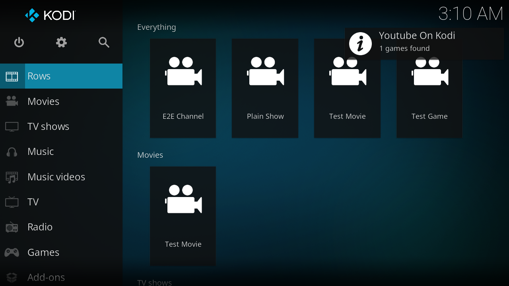

# Home rows (design and verification)

`rows.py` (pure) turns the Kodi video library (movies, TV shows, episodes via
JSON-RPC) and `games.json` into items and rows; `default.py` exposes them as
plugin directories `mode=rows` (the row list) and `mode=row&id=<row>`.

**Verified** (Kodi 21.3, e2e `test_rows`): with a YouTube channel, a plain TV
show, a movie and a game, `Everything` lists them in release/air-date order,
the per-type rows filter correctly, and `unwatched` shows the channel after one
of its videos is marked watched.

## Rules

- One sort date per item, newest first, undated last, ties by title: movie =
  `premiered` (else `year`), show/channel = newest aired episode, game =
  release date.
- Channel = TV show tagged `YouTube`.
- "Shows with unwatched episodes": at least one watched episode and at least
  one dated unwatched episode; sorted by the newest unwatched episode.
- Rows with no items are hidden, except Everything. One games row per system
  present in `games.json`.
- Shows open their Kodi library page (`videodb://tvshows/titles/<id>/`),
  movies play, games launch through the add-on.

## Notes and limits

- The catalog is built on every directory request: three library queries plus
  `games.json`. `GetEpisodes` has no limit, which is fine for personal libraries
  and is the thing to page or cache first if it gets slow.
- Kodi runs one plugin at a time: a second `Addons.ExecuteAddon` pre-empts the
  first, and a call straight after a fresh profile's first start is dropped.
  The e2e tests work around both.

## The skin (Estuary Rows)

`skin.nix` + `skin/estuary-rows.patch` + `skin/Includes_Rows.xml`. Estuary's
home screen has hardcoded widget rows and no hook for custom ones, so the
rows needed a skin. The skin is Estuary from the Kodi package with a patch:
a first menu entry (`yokrows`) and a group of `WidgetListPoster` widgets whose
`content_path` is the add-on's row directories. The patch touches only
`Home.xml`, `Includes.xml` and `addon.xml`.

**Verified** (e2e `SkinTest`): the skin loads, "Rows" is the first menu entry
and the default selection, and widgets 8100..8600 hold the right items in the
right order. `YOK_SCREENSHOTS=<dir> nix run .#e2e -- test_rows` saves
`home-rows.png`.

Findings worth remembering:

- Only enabled add-ons can be the skin, and a skin that is not one of Kodi's
  system add-ons starts out disabled. Kodi loads the skin before JSON-RPC is
  up and rewrites `guisettings.xml` on exit, so the e2e harness enables the
  skin, quits Kodi, sets `lookandfeel.skin` while it is stopped, and relaunches.
- A skin must be built with `buildKodiAddon` for `kodi.withPackages` to include it.
- The patch is applied at build time; a Kodi update that changes those Estuary
  files makes the build fail rather than silently dropping the rows.

### Widget count: Kodi crashes with too many at once

Kodi starts every home widget's plugin script at the same moment. With 15
widgets (one per game system) Kodi 21.3 **segfaulted** during startup inside its
embedded Python (`_PyThreadState_MustExit`, libpython 3.13); runs with 6 or 7
widgets never did. So the skin has 7: the six rows plus one "Games by system"
card list (`mode=systems`), whose cards open the per-system rows
(`mode=row&id=games:<system>`). `test_skin_stays_under_the_widget_limit` caps
the count at 8. This probably also explains intermittent e2e failures seen
earlier (empty widgets, dropped `ExecuteAddon` calls) while widgets were being
added.

### Catalog cache

Each widget request would rebuild the catalog (three library queries), so it is
cached in `catalog_cache.json` for `catalog_cache_seconds` (default 20). The
background service deletes the cache on `VideoLibrary.On*` notifications and
`Player.OnStop` (watched state), so widgets refresh right after a library
change; a TTL alone served a stale, empty catalog right after a library
update. Without the service, only the TTL applies.

### Game cards

A game's card uses `DefaultAddonGame.png`. Selecting it opens
`plugin://...?mode=game&id=<id>`, which launches it in RetroPlayer (e2e
`test_game_card_url_opens_like_a_widget_click`). A supported system with no
games is an empty row, not an error.

Not done: movie/show artwork fallbacks beyond Kodi's own, per-row sort
controls, and a skin screenshot with real artwork.
