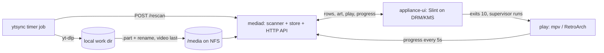

# Media appliance (replaces Kodi on nuc14)

Status as of 2026-10-19. Source of truth is the code under `appliance/`; this page records what
is built, how it was verified, and what is still open.

## Goal

A fixed-purpose living-room media appliance on `nuc14` (Intel N150, NixOS) that replaces Kodi,
whose embedded Python crashes (measured, see [Home rows](Home-rows)). One display mode,
3840x2160@60, no refresh switching. Microservice style: no process embeds Python, and yt-dlp is
an external process run by a timer job. Everything is local files on `/media` (NFS 4.1 from a
Synology), including YouTube downloads.

## Architecture

| Piece | Crate / path | State |
|-------|--------------|-------|
| Row engine | `catalog` | done, unit tested |
| Library scanner | `scanner` | done: movies, tv, youtube, roms |
| Store (SQLite) | `store` | done: entries, episodes, play_state; empty-scan guard |
| Library daemon | `mediad` | done: HTTP API on 127.0.0.1:8730 |
| YouTube download job | `ytsync` | done; verified live (see below) |
| Kodi watch-state import | `kodiimport` | done; comparison on the NUC pending |
| Player | `player` (`play`) | done; verified with real mpv in a VM |
| UI | `ui` (`appliance-ui`) | spike: renders, navigates, hands off to `play` |
| NixOS module | `module.nix` | mediad + ytsync; the UI is not wired in yet |

## How it was verified

Everything below runs with `nix build .#checks.x86_64-linux.<name> -L` (VM tests need KVM).
Rust tests: `nix build .#appliance` runs the workspace tests.

| Check | What it proves |
|-------|----------------|
| `appliance` | Module under its hardening: `mediad` ordered after `media.mount`; `ytsync` (ProtectSystem=strict) writes `/media/youtube`; a fake yt-dlp's video, sidecar and channel poster appear in `/rows/channels`, `/rows/everything` and `/items/{id}/art` |
| `appliance-player` | Real mpv (null outputs): resume with `--start`, progress posts, quit-at-once keeps the resume point, end of file marks watched |
| `appliance-handoff` | A stand-in UI holds DRM master on a virtio-gpu display: mpv is refused ("Failed to acquire DRM master"), and after the drop three consecutive `play` runs succeed and master is retaken each time |
| `appliance-ui` | Slint at 3840x2160, 2x scale, software renderer: posters with artwork, Hebrew RTL title, key focus, Enter hands the display to real mpv and the UI returns with focus restored |

### Live ytsync run (real yt-dlp, `@NASA`, 1 channel, 1 video)

The flags in `ytdlp_args` all work: format string, match filter, `--dateafter`, jpg thumbnail
conversion, mkv merge, output template. yt-dlp needs a JS runtime (deno). Findings:

- yt-dlp also wrote a playlist-level `.info.json`, which ytsync counted as an undelivered video.
  Fixed with `--no-write-playlist-metafiles`.
- The video `.info.json` was 10.9 MB (format lists). ytsync now slims it to the fields the
  appliance reads (about 1 KB).
- Channel art: a second, metadata-only yt-dlp call fetches the channel's square avatar
  (`avatar_uncropped`), delivered once as `poster.jpg`; the scanner already looks for that name.
  It must not use `--no-write-playlist-metafiles`, which also drops playlist thumbnails.

## UI spike findings

- Slint's `hide()` does not release DRM master, so `play` cannot start from inside the UI
  process. The UI exits with status 10 (item id in `$UI_STATE/launch`, focus saved); the
  supervisor `appliance-ui-session` runs `play <id>` and starts the UI again.
- No getty may run on the display's VT: with one, the first frame never reached the screen.
- Hebrew right-to-left titles render correctly with Noto and DejaVu fonts via fontconfig.
- Slint gotchas: `row` and `col` are reserved property names; an element without an explicit
  `y` is centered in its parent.
- Not covered: GPU rendering on the N150, 4K smoothness, the RF remote's key codes,
  unprivileged operation (libseat), async art loading, watched marks.

## API gaps (not changed yet)

- `Item.watched` counts episodes only, so a movie never reports watched through `mediad`.
- Episode `duration` is 0 until played; the slimmed sidecar keeps `duration` so a scan could fill it.

Both would be additive changes to the `mediad` response; they are waiting for an explicit OK.

## Decisions

Fixed mode 3840x2160@60. YouTube is downloaded by ytsync and treated as local media. N64 is
post-MVP. mpv for video. UI and player are separate processes with a display handoff. Games run
in RetroArch, launched per game. One sort date per item. Kodi stays installed until a
parallel-run period ends.

## Hardware-only gates (NUC)

HDR10 at 4K60 (the link is YCbCr 4:2:0 8-bit today), Dolby Vision via the HDR10 base layer,
VA-API decode (H.264, HEVC10, VP9, AV1 per probe), AC-3/E-AC-3 passthrough (the TV accepts only
2ch LPCM, AC-3, E-AC-3; DTS must be re-encoded or downmixed), 80 Mbps remux over NFS, UI
smoothness on the N150, and the `mpv_args` flags.

## Open questions

YouTube retention (5 newest, 30 days, 1080p are placeholders; deleting watched videos after N
days is not implemented), where the download job runs long term, NFS `soft` vs `hard`,
on-screen keyboard and settings scope, and converting the ~190 plain-name entries in the old
`channels.conf` to @handle, URL or id (ytsync skips them with a warning).
